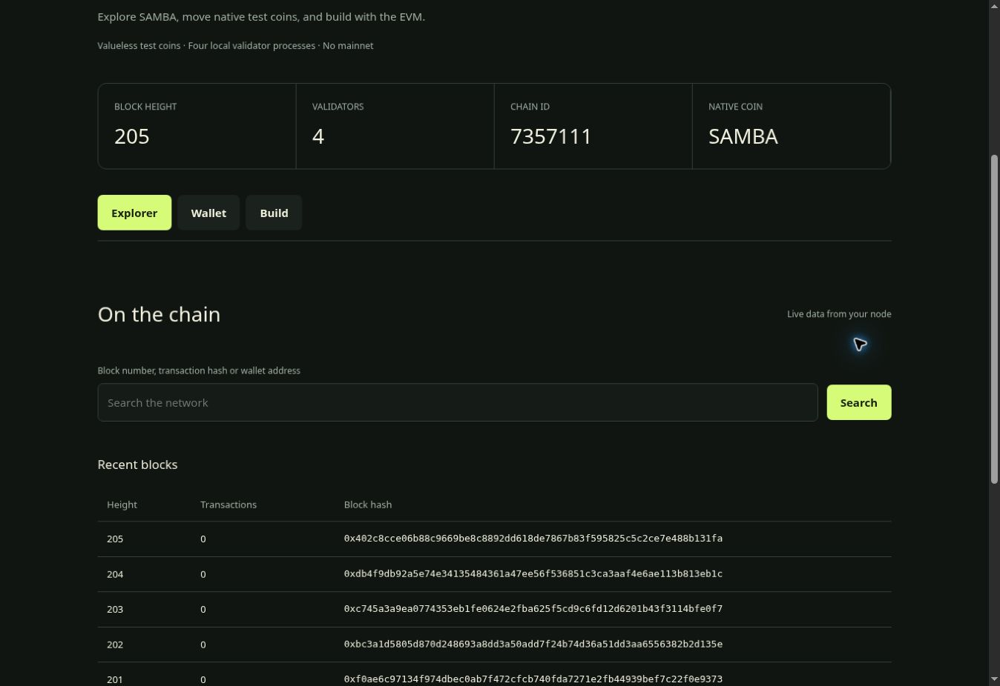

# SAMBA

An independent Cosmos EVM Layer-1 **private development network** with its own genesis, native SAMBA coin, four validator processes, P2P consensus, Ethereum JSON-RPC and Solidity execution. SAMBA is not an ERC-20 or a Sepolia deployment and does not settle on another blockchain.

**Status:** working local devnet verified with real transactions and contracts. **Not mainnet ready.** No public testnet endpoint, coin sale, exchange listing, paid hosting or production deployment exists. Automated Go vulnerability findings remain a deployment blocker; see [SECURITY.md](SECURITY.md).

## Quick start

Requirements: Linux, compatible Go >=1.25.9, GCC/CGO, Python >=3.11, Node >=24, npm and Git.

```bash
npm ci --ignore-scripts
bash scripts/build.sh
npm run compile
python3 scripts/devnet.py init
bash scripts/run-checks.sh
```

The checks start four real separate node processes, send signed native transfers, deploy and call Counter, test replay/double spending, encrypted keystores and faucet controls, halt/resume consensus and verify catch-up. Evidence is written to `evidence/integration.json`. This is reproducible execution, not simulated blockchain data. The harness stops processes when it completes.

For interactive use, keep `python3 scripts/devnet.py run` alive, then in another terminal on the same host/network namespace run `npm run portal` and open **http://127.0.0.1:8080**. All listeners bind loopback. Save your encrypted test keystore before closing the wallet.

| Setting | Development value |
|---|---|
| Chain name | SAMBA |
| Native coin symbol | SAMBA (provisional symbol) |
| Cosmos / EIP-155 chain ID | 7357111 |
| Native denomination | asamba, 18 decimals |
| EVM RPC | http://127.0.0.1:8545 |
| Consensus RPC | http://127.0.0.1:26657 |
| Portal / explorer / wallet | http://127.0.0.1:8080 |
| Consensus | CometBFT + Cosmos SDK stake-weighted validator set |
| Upstream source | Cosmos EVM v0.7.4, exact commit pinned in build script |



## Components

- `scripts/`: exact-source build, fresh genesis, node orchestration and real network test runner.
- `services/`: local allowlisted JSON-RPC gateway, real native-coin faucet, persistent SQLite limits.
- `apps/portal/`: live block/transaction/address explorer, validator statistics, browser-local test wallet with encrypted keystore, developer panel.
- `contracts/`: Solidity Counter and compiled ABI/bytecode.
- `tests/`: security guards and real four-node integration suite.
- `docs/`: architecture/research, developer setup, coin policy, validator operations and mainnet readiness.
- `evidence/`: actual test results and vulnerability scans. Private keys, seeds, node DBs and raw logs stay ignored under `.devnet`.

The configured chain inherits SDK auth/bank/staking/distribution/slashing/governance plus Cosmos EVM/CometBFT. We have not written a new consensus or cryptographic algorithm. Four local validators are separate processes, not independent organizations or geographic decentralization. Explorer address history is bounded to the latest 200 blocks; there is no archival indexer.

See [operations](docs/OPERATIONS.md), [developer guide](docs/DEVELOPERS.md), [coin policy](docs/COIN_POLICY.md), [technology research](docs/ARCHITECTURE.md), [third-party licenses](THIRD_PARTY.md) and [Mainnet Readiness Report](docs/MAINNET_READINESS.md).
